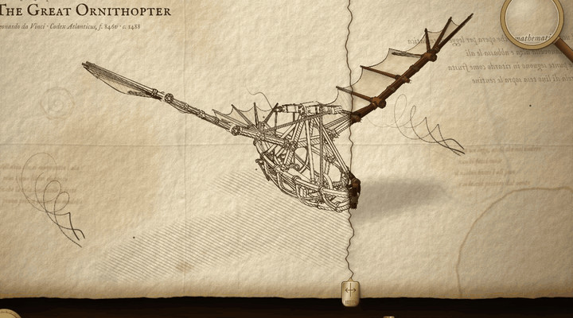
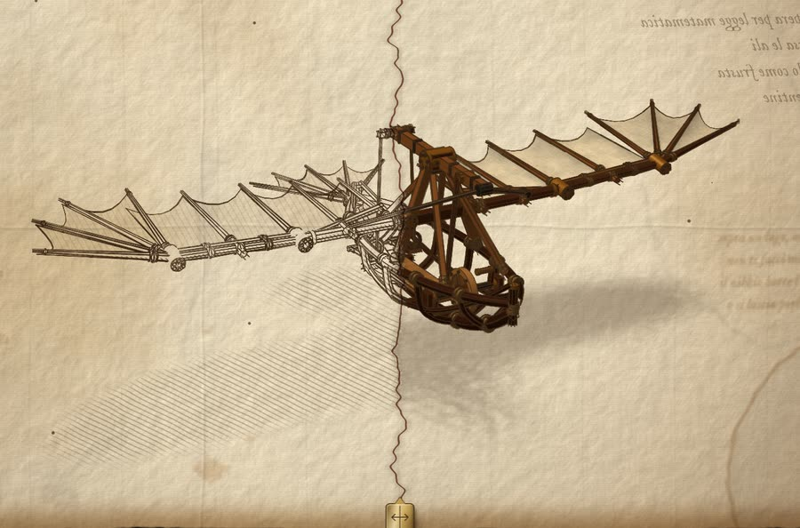
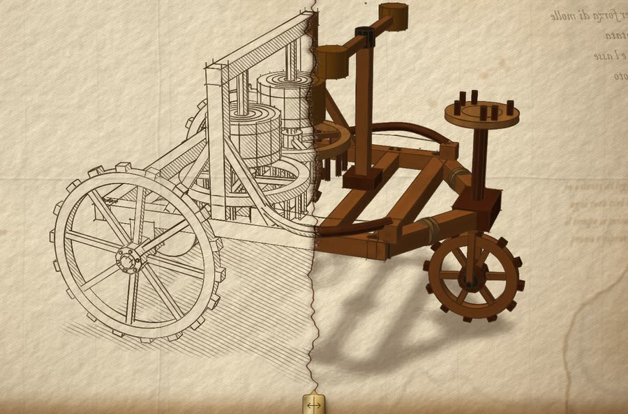
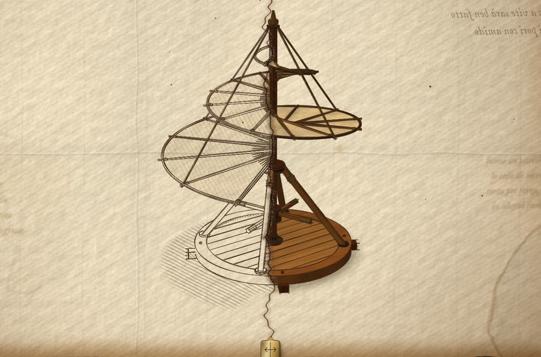
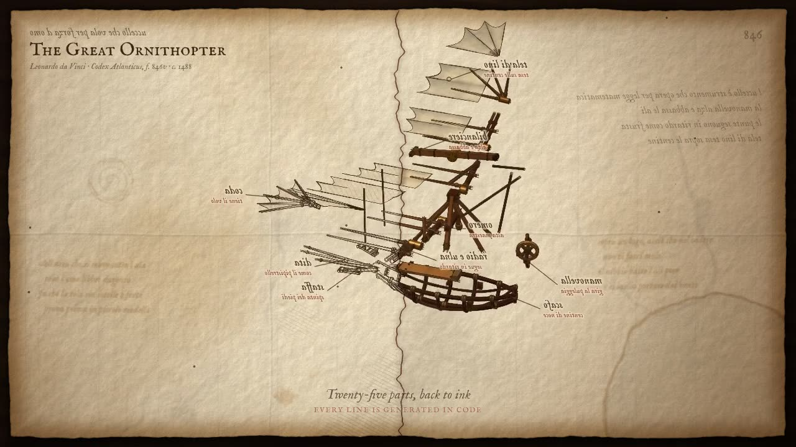
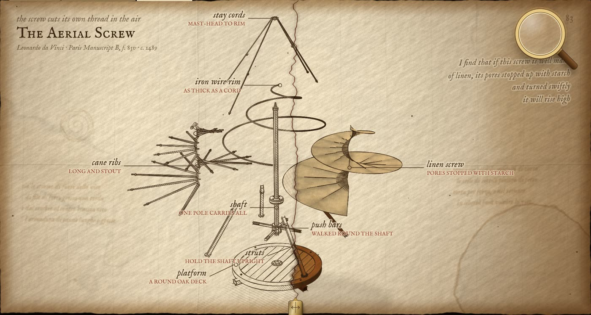
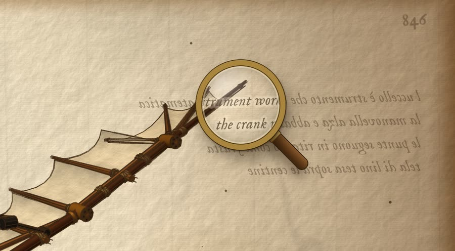
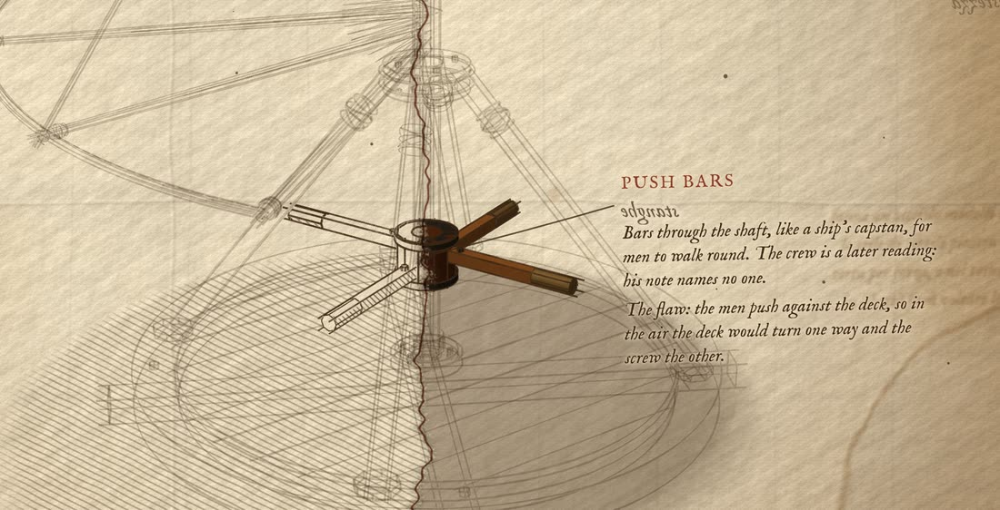
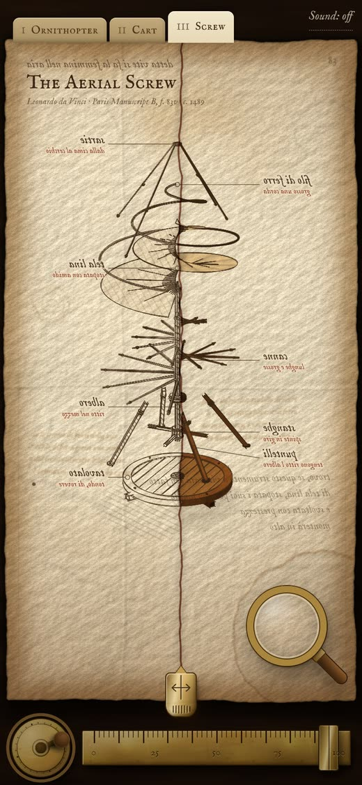

# Da Vinci's Living Codex

Three of Leonardo da Vinci's machines, the ornithopter, the self-propelled cart and the aerial screw, each drawn in ink on a notebook leaf and rebuilt in timber, in the browser. Everything is generated in code: the geometry, the paper, the ink lines and the sound. The page itself loads no image, model or audio files (the pictures below are only screenshots for this README).

**[Open it in your browser → davinci-mechanics.vercel.app](https://davinci-mechanics.vercel.app)**



<table>
  <tr>
    <td width="33%"><a href="https://davinci-mechanics.vercel.app"></a></td>
    <td width="33%"><a href="https://davinci-mechanics.vercel.app/#m=cart"></a></td>
    <td width="33%"><a href="https://davinci-mechanics.vercel.app/#m=screw"></a></td>
  </tr>
  <tr>
    <td align="center"><b>I · The Great Ornithopter</b><br><sub>Codex Atlanticus f. 846v · c. 1488</sub></td>
    <td align="center"><b>II · The Self-Propelled Cart</b><br><sub>Codex Atlanticus f. 812r · c. 1478</sub></td>
    <td align="center"><b>III · The Aerial Screw</b><br><sub>Paris Manuscript B f. 83v · c. 1489</sub></td>
  </tr>
</table>

### The 15-second cut (click to play)

[](docs/media/codex-15s.mp4)

<sub>Click the picture to play the video (`docs/media/codex-15s.mp4`). It is the page's own cinematic mode, recorded straight from the browser.</sub>

### Pull it apart, read the notes, hold up the mirror



<table>
  <tr>
    <td width="40%"></td>
    <td width="60%"></td>
  </tr>
  <tr>
    <td align="center"><sub>Leonardo wrote backwards. Drag the hand mirror over his notes to read them.</sub></td>
    <td align="center"><sub>Tap any part: the rest fades back to a sketch and a note is written on the page.</sub></td>
  </tr>
</table>



**On a phone** the same objects are sized for a thumb, and a tall sheet gets its own layouts: here the aerial screw comes apart as a tower, with the names written down both margins.

<br clear="right">

## Run it

Open `index.html` in a browser. It is one file with no build step. It needs a network connection the first time, to fetch three.js (pinned to 0.170.0 on jsDelivr) and the IM Fell English fonts (Google Fonts, SIL Open Font Licence).

## What you can do on the page

The sheet lies on a walnut desk. The instruments lie on the strip of desk below the sheet, so nothing covers the drawing.

- Scroll, hold Space, or turn the brass crank (bottom left) to drive the machine. It coasts when you stop. Tap the crank to stop the machine, tap again to start it.
- Drag the brass rider on the lower edge of the sheet to move the border between the ink sketch and the timber model. Push it to either edge for all ink or all timber; two quick taps put it back in the middle. With a mouse you can also drag the line itself.
- Slide the brass rule (bottom right) to pull the machine apart while it keeps moving.
- Hover a part to see its name, click or tap it for a note written on the page.
- Drag the hand mirror over the mirror writing to read it. Click the mirror to turn the whole page.
- The tabs above the sheet turn to the other leaves: I Ornithopter, II Self-Propelled Cart, III Aerial Screw.
- Top right: `Sound` turns on the synthesised audio.

Keys: `1` `2` `3` ink / half / timber, `M` mirror, `S` sound, `+` `-` zoom, `Esc` close a note.

The aerial screw turns once for each turn of the crank. Drive it well past its working speed (scroll, or wind the crank fast) and it lifts off its shadow, while the deck creeps round the other way: the men push against the deck, so nothing holds it still. Pulled apart on a wide sheet, its canes, wire and cloth are set down beside the shaft and go on turning there; on a tall sheet they are lifted off above it, one over the other.

On a phone the same objects are sized for a thumb. On a tall screen the machine starts three-quarter on so both wings fit, the mirror writing and the mirror move to the foot of the sheet, part notes are written across the page under the machine, and the names in the pulled-apart view go in two columns down the margins.

## Maker tools

Visitors do not see the recording tools. Add `#maker=1` to the address to get them (`#maker=0` hides them again; the setting is not stored):

- `Record` (top right) opens a drawer: Workbench / Cinematic mode, the 20 s story and the 15 s looping cut, recording frames (9:16, 1:1, 16:9) and a clean frame.
- A speed plaque with an AUTO switch beside the crank, and an INK / HALF / TIMBER plate.
- Extra keys: `R` record drawer, `H` clean frame, `C` captions, `A` auto-drive.

An address that already asks for a recording state (`mode`, `preset`, `ar`, `clean`, `rec` or `t` in the hash) turns the maker tools on by itself, so old recording links keep working.

## Files

| File | What it is |
| --- | --- |
| `index.html` | The page. This is the source; edit it directly. |
| `build.mjs` | Build step: minifies the inline CSS and scripts into `dist/index.html` for publishing. |
| `og.jpg` | Preview image for link cards. |
| `docs/media/` | Screenshots, the animated picture and the 15-second video used in this README. Not part of the page. |
| `index-v1.html` | The first version of this page, kept for comparison. |
| `cart-original.html` | The cart-only page the project started from. |
| `compare.html`, `compare/` | Drag-to-compare screenshots of the first version against the second. |
| `compare-v3.html`, `compare/v3/` | Drag-to-compare screenshots of the second version against the third (phone layout, desk strip, rider). |
| `compare-v4.html`, `compare/v4/` | Screenshots and screen recordings of the third leaf, the aerial screw. |

The published site is `dist/index.html` (built), not the source `index.html`. `index-v1.html`, `cart-original.html`, the compare pages and `compare/` stay in the repository only.

## Build and deploy

The deployed page is minified so it loads faster (about a third smaller); the readable source is `index.html`, here in the repository.

```
node build.mjs        # writes dist/index.html (inline CSS and JS minified by esbuild) + dist/og.jpg
vercel deploy --prod --yes --scope coding-nanami dist
```

esbuild is fetched on demand via `npx`; nothing is added to the repository. `dist/` is generated and git-ignored; `build.mjs` copies the Vercel project link into it so the deploy targets the same `davinci-mechanics` project.

## Starting states for testing and recording

The URL hash sets a starting state, for example:

- `#mode=cine&preset=viral&t=9.6` — the 15 s cut, paused at 9.6 s
- `#style=ink&explode=100&auto=0&phase=1.2&az=0.87` — ink sketch, fully pulled apart, frozen
- `#m=cart`, `#m=screw` — open on the cart, or on the aerial screw
- `#ar=9:16&clean=1` — portrait recording frame without controls
- `#nohint=1` — no hand-written prompts and no opening slide of the divider

`window.__seek(t)` jumps the cinematic timeline to `t` seconds. `window.__codex` exposes the live state and the setters used in testing.

## Accuracy

The machines are reconstructions made for this page, not measured copies of the drawings. The Italian mirror-script lines and the notes on the parts were written for this page and have not been checked by a historian.

On the aerial screw, the title line and the four margin notes are Leonardo's own sentence about it ("Trovo, se questo strumento a vite sarà ben fatto … monterà in alto"), as quoted on the Italian Wikipedia page "Vite aerea"; it was not checked against the manuscript. The show-through writing and the part names are from memory of the rest of his note and are unchecked. The crew of four on the platform is a later reading (his note names no driver), and the struts, collar, push bars and stay cords are this page's guess at what the sketch leaves out.

## Licence

The code is under the MIT licence: see `LICENSE`. Use it, change it, sell it; keep the copyright notice.

Not covered by that licence, and not in this repository: three.js (MIT, fetched from jsDelivr) and the IM Fell English fonts (SIL Open Font Licence, fetched from Google Fonts). Leonardo's own words quoted on the page are in the public domain.
